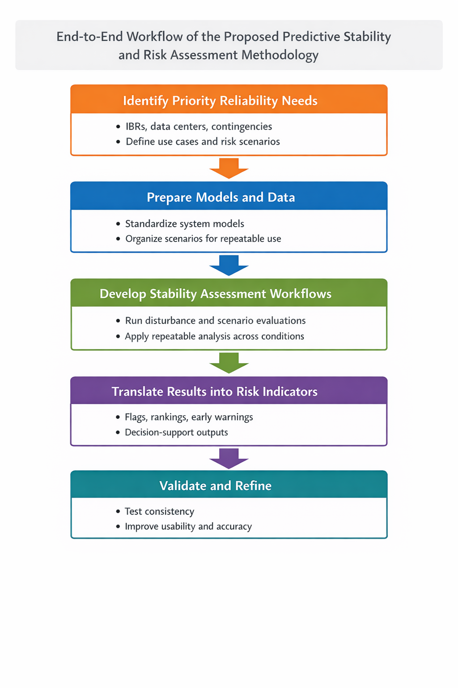
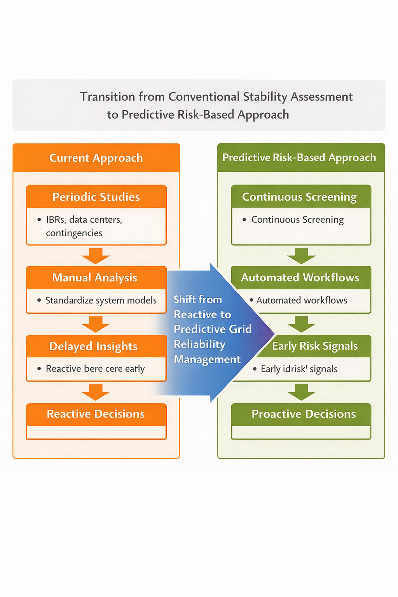

# predictive-stability-risk-assessment-methodology

# 2.3 Methodology

## Phase 1: To Identify Priority Reliability Needs and Use Cases

I will begin by identifying the specific reliability situations where predictive stability and operational-timeframe risk insight are most needed. This includes conditions associated with increasing inverter-based resource penetration, rapid growth of data-center and industrial loads, and credible operating contingencies. The emphasis in this phase is to define and document priority use cases, including what early-warning or screening outputs would most improve operational and planning decision-making, and where existing tools are slow, fragmented, or difficult to apply in practice.

## Phase 2: To Prepare and Organize Data and Models for Consistent Assessment

In this phase, I will establish a structured foundation of system models, operating conditions, and scenario inputs needed to support repeatable stability and risk assessments. This includes organizing network configurations, dynamic models, and representations of inverter-based resources and large loads so they can be evaluated consistently across operating conditions. The focus is on repeatability and internal consistency through standardized model and scenario preparation, reducing reliance on ad hoc manual workflows and enabling consistent comparison across study cases.

## Phase 3: To Develop Repeatable Stability and Risk Assessment Workflows

Using established power-system analysis methods, I will develop workflows that evaluate how the system behaves under disturbances and changing conditions. Rather than producing one-off studies, this phase emphasizes repeatable assessment processes that can be applied across multiple scenarios and operating conditions, reflecting modern grid characteristics such as inverter-based resource behavior and large-load dynamics. The intended output is a workflow that supports consistent screening and prioritization of operating scenarios for follow-up study when elevated stability risk is indicated.

## Phase 4: To Translate Technical Results into Practical Decision Support

This phase focuses on converting technical outputs into forms that can be readily interpreted and applied in real-world contexts. I will produce clear decision-support outputs such as risk indicators, prioritized flags, and comparative screening results, that help stakeholders recognize when and where stability risk is increasing and what operating conditions are contributing to that risk. The goal is to support faster understanding and more informed action without requiring deep technical interpretation for every use case, while ensuring that outputs remain traceable to underlying assumptions and modeled conditions.

## Phase 5: To Validate, Refine, and Support Practical Use

Finally, I will validate and refine the tools and workflows through structured testing and feedback. This includes checking results for consistency across comparable conditions, benchmarking performance against representative system behaviors and study expectations, and iterating based on how users interpret and apply the outputs. Deployment will occur in bounded, realistic stages, supported by clear documentation describing appropriate use, underlying assumptions, and limitations so that stakeholders can apply the outputs responsibly and consistently.

Figure 1: End to End Workflow of the proposed predictive stability of Risk Assessment Methodology

Table 1: Comparison of Conventional Grid Stability Assessment Practices and My Proposed Methodological Approach

| Aspect of Grid Stability Assessment | Conventional Industry Practice | Shortfalls in Current Practice | My Methodological Approach |
|---|---|---|---|
| Timing of Stability Analysis | Stability studies are conducted periodically as part of long planning cycles or interconnection studies. | Emerging risks may go undetected between study cycles, reducing operators' ability to anticipate rapidly changing conditions. | I develop predictive and repeatable analytical workflows that enable more frequent screening of operating conditions and earlier identification of emerging stability risks. |
| Data Processing and Model Evaluation | Analysis relies heavily on manual engineering review of large datasets and model outputs. | Manual workflows can be slow, resource-intensive, and difficult to scale across large power systems. | My approach introduces automated analytical tools that streamline model validation, data processing, and scenario evaluation to improve speed and consistency. |
| Integration of Emerging Grid Conditions | Traditional models were primarily designed for systems dominated by synchronous generation. | Increasing penetration of inverter-based resources and large electronic loads creates behaviors not fully captured by legacy assumptions. | My methodology incorporates advanced modeling and validation techniques tailored to modern grid characteristics and evolving resource mixes. |
| Operational Relevance of Results | Stability studies often produce detailed engineering reports primarily used for planning purposes. | Translating complex results into operational insights can be difficult and time consuming. | I design analytical frameworks that translate simulation outputs into structured risk indicators, improving situational awareness for planners and operators. |
| Scalability Across the Grid | Studies are typically performed for specific projects, regions, or scenarios. | This limits the ability to apply insights consistently across large interconnected systems. | My methodology emphasizes scalable analytical frameworks capable of supporting broader system-level risk assessment and decision making. |

Figure 2: Transition from conventional Stability Assessment to Predictive Risk-Based Approach

